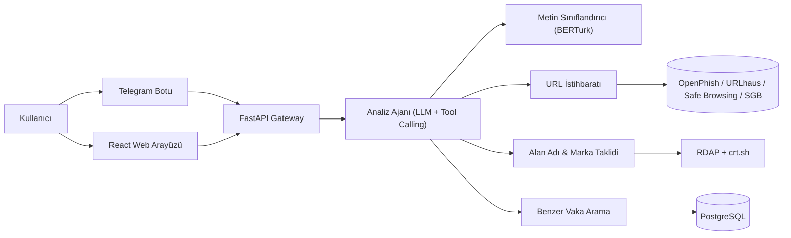

# SahteMi — Türkçe Dolandırıcılık & Oltalama Analiz Ajanı

[](https://github.com/BinnurAltnsk/SahteMi/actions/workflows/ci.yml)

**SahteMi**, SMS, WhatsApp, Instagram DM ve ilan sitelerinden gelen şüpheli Türkçe mesajları ve bağlantıları analiz ederek **gerekçeli risk kararı** üreten bir yapay zekâ ajanı ve tehdit istihbaratı platformudur.

## Neden SahteMi?

- Akademik Türkçe smishing çalışmaları çoğunlukla statik veri setlerinde %98–99 doğruluk raporlar, ancak dolandırıcılar kalıp değiştirdiğinde (kavram kayması / concept drift) bu performans ciddi biçimde düşer.
- SahteMi bu problemi **hibrit ve ajan tabanlı** bir mimariyle ele alır:
  1. **Türkçe Metin Sınıflandırıcı (BERTurk + ONNX):** Zamana göre ayrılmış (temporal split) testlerle gerçek dünya başarımı ölçülür.
  2. **Tehdit İstihbaratı & Alan Adı Analizi:** OpenPhish, URLhaus, Google Safe Browsing, SGB/USOM API, RDAP alan yaşı ve `crt.sh` üzerinden marka taklidi tespiti.
  3. **LLM Analiz Ajanı (Tool Calling):** Tüm sinyalleri birleştirip kullanıcıya sade Türkçe ile *neden* şüpheli olduğunu açıklar.

## Mimari



## Proje Yapısı

```text
SahteMi/
├── api/        # FastAPI servisi, ajan katmanı, araçlar ve testler
├── ml/         # Veri hazırlama, EDA, BERTurk eğitimi, zamansal değerlendirme
├── ingest/     # Tehdit beslemelerini çeken zamanlanmış toplayıcılar
├── bot/        # Telegram botu
├── web/        # React + Tailwind arayüzü ve istatistik paneli
├── evals/      # Ajan açıklamaları için doğruluk (eval) test seti
├── Dockerfile
└── docker-compose.yml
```

## Hızlı Başlangıç

### 1. Ortam Değişkenleri

```bash
cp .env.example .env
```

### 2. Docker Compose ile Çalıştırma

```bash
docker compose up --build
```

Servis ayağa kalktıktan sonra:
- Sağlık kontrolü: `http://localhost:8000/health`
- Swagger API dokümantasyonu: `http://localhost:8000/docs`

### 3. Yerel Geliştirme ve Testler

```bash
python -m venv .venv
# Windows PowerShell:
.\.venv\Scripts\Activate.ps1
pip install -e ".[dev]"

ruff check .
pytest -v
```

## Değerlendirme Metrikleri

| Model / Aşama | Rastgele Ayrım (2021) F1 | Zamana Göre Ayrım (2026) F1 | Yanlış Alarm (2026 FPR) | p95 Gecikme |
|---|---:|---:|---:|---:|
| TF-IDF + Lojistik Regresyon (Baseline) | %98.9 | **%81.6** (-17.3 puan) | %16.0 (2021'de %0.7) | — |
| BERTurk Fine-Tuned (ONNX int8) | — | — | — | — |
| Hibrit Ajan (BERTurk + URL/Domain + LLM) | — | — | — | — |

> Detaylı analiz: [01_eda_report.md](ml/notebooks/01_eda_report.md) · [02_baseline_eval.md](ml/notebooks/02_baseline_eval.md)

## Yol Haritası

- [x] **Gün 1:** Monorepo iskeleti, FastAPI servisi, Docker Compose, Ruff + Pytest + GitHub Actions CI
- [ ] **Hafta 1:** Veri toplama/maskeleme (KVKK uyumlu), EDA, baseline model, kural motoru
- [ ] **Hafta 2:** URL tehdit istihbaratı toplayıcısı, RDAP & marka taklidi tespiti, Telegram botu, ilk canlı dağıtım
- [ ] **Hafta 3–4:** BERTurk ince ayarı, ONNX int8 dönüşümü, zamana göre ayrım kıyaslaması
- [ ] **Hafta 5:** LLM tool-calling ajanı ve `evals/` doğruluk test seti
- [ ] **Hafta 6–8:** Ekran görüntüsü (OCR), React paneli ve canlı kullanıcı geri bildirim döngüsü
